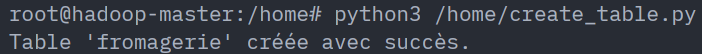
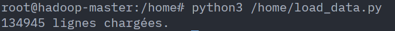
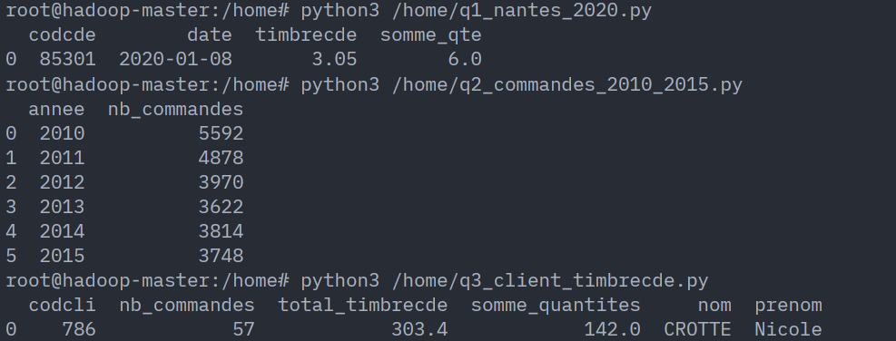

# Démarche HBase (LOT 4)

Ce document retrace ce qui a été fait pour le LOT 4 (HBase). 
## Environnement technique

Voir repository github : [https://github.com/DiginamicAcademy/Hadoop.git](https://github.com/DiginamicAcademy/Hadoop.git)

---

## 1 : démarrer

On démarre HBase avec le reste du cluster (`start-all.sh`).

**Commandes** (dans le conteneur master) :

```bash
./`start-all.sh`
```

---

# 2 : concevoir le schéma et choisir le rowkey

On choisit le rowkey en fusionnant les valeur unitaires necessaires pour repondre aux questions :

|Question|Ce qu'elle demande à HBase|
|---|---|
|Q1 : meilleure commande de Nantes en 2020|Lire une seule année|
|Q2 : commandes de 2010 à 2015, par année|Lire une plage d'années|
|Q3 : client avec le plus de frais `timbrecde`|Lire toute la table|

## Rowkey retenu : `datecde_codcde_codobj`

Format date : AAAAMMJJ
Exemple : `20041022_00000478_000038`

|Élément|Raison|
|---|---|
|**Date en tête** (`AAAAMMJJ`)|Les clés sont triées par date : une année (`row_prefix=b'2020'`) ou une plage (`2010` à `2016` exclu) se lit sans parcourir toute la table. C'est ce qui sert les questions 1 et 2.|
|**`codcde` puis `codobj`**|Une ligne du fichier est un article d'une commande : le couple commande + objet rend la clé unique|
|**Codes complétés par des zéros** (`00000478`)|HBase trie les clés comme du texte : sans zéros, `478` passerait après `21239`|

## Familles de colonnes

|Famille|Colonnes|
|---|---|
|`client`|codcli, nom, prénom, ville, cp|
|`order`|codcde, datcde, timbrecde, codobj, qte, libobj|


---

# 3 : créer la table

**Script :** `01_create_table.py`

Le script supprime la table si elle existe déjà, puis la recrée : on peut le relancer pour repartir de zéro.

**Commande :**

```bash
python3 /home/01_create_table.py
```

**Résultat.** Message « Table 'fromagerie' créée avec succès ».  


---

# 4 : charger le CSV qualifié dans HBase

**Script :** `02_load.py`

**Points clés :**

|Élément|Explication|
|---|---|
|Lecture avec le module `csv`|Il comprend les guillemets : les 12 lignes dont le champ `prenomcli` contient des virgules sont lues correctement. Contrairement à Hive, aucune conversion en TSV n'est nécessaire.|
|Séparateur `,`|Vérifié sur l'en-tête du fichier : c'est une virgule|
|`table.batch(batch_size=5000)`|Les lignes sont envoyées par paquets de 5 000 et non une par une : le chargement est bien plus rapide|
|Ville en majuscules|Les requêtes comparent la ville à `NANTES`|
|Colonnes vides|Une valeur vide (NULL) est écrite telle quelle ; la décision d'équipe est de la traiter comme 0 pour les colonnes numériques concernées (voir étape 5)|

**Commande :**

```bash
python /home/02_load.py
```

## Résultat



---

## Étape 5 : les trois requêtes

Chaque requête est un script Python indépendant, qui interroge HBase avec happybase puis exporte son résultat avec pandas.

## Une précaution commune : les valeurs vides

Certains `timbrecde` sont vides dans le fichier (NULL conservés au LOT 0 car non critiques, voir le support de soutenance). Un `float('')` plante. La décision de l'équipe : **remplacer les NULL de `timbrecde` par 0**, car c'est une valeur numérique. Dans les scripts, une petite fonction de conversion applique cette règle :

```python
def nombre(valeur):
    try:
        return float(valeur)
    except (ValueError, TypeError):
        return 0.0
```

## Question 1 : meilleure commande de Nantes en 2020

**Script :** `03_query1_nantes_2020.py`

**Méthode.**

1. Scan limité aux clés qui commencent par `2020` (`row_prefix=b'2020'`) : seule l'année 2020 est lue, pas toute la table.
2. Filtre sur la ville `NANTES`.
3. Somme des quantités par commande.
4. Meilleure commande : plus grande somme des quantités, puis plus grand `timbrecde`. C'est la **même définition qu'au LOT 2** (Hive).

**Livrable :** `q1_nantes_2020.csv`

## Question 2 : nombre de commandes de 2010 à 2015, par année

**Script :** `04_query2_commandes_par_annee.py`

**Méthode.**

1. Scan de la plage `row_start=b'2010'` à `row_stop=b'2016'` (borne exclue : toute l'année 2015 est incluse).
2. On garde les couples (année, `codcde`) **distincts** : une commande occupe plusieurs lignes, elle ne doit être comptée qu'une fois.
3. Comptage par année, puis graphique en barres.


**Livrables :** `q2_commandes_par_annee.pdf` (barplot) et `q2_commandes_par_annee.csv`

## Question 3 : client avec le plus de frais `timbrecde`

**Script :** `05_query3_client_max_timbrecde.py`

**Méthode.**

1. Scan complet de la table (le client n'est pas dans la clé : aucune lecture ciblée possible).
2. `timbrecde` est répété sur chaque ligne d'une commande : on ne le garde **qu'une fois par commande** (`drop_duplicates` sur client + commande), sinon un client serait pénalisé pour chaque article acheté.
3. Regroupement par client : nombre de commandes et somme de `timbrecde`.
4. Somme des quantités par client, puis le client en tête.


**Livrables :** `q3_client_max_timbrecde.xlsx` et `q3_client_timbrecde.csv`

## Résultats

1. Sortie des trois scripts dans le terminal.

2. Le barplot de la question 2.

[exports/q2_commandes_par_annee.pdf](exports/q2_commandes_par_annee.pdf)
---

# 6 : exporter les données pour PowerBI

**Script :** `06_export_lignes.py`. Il lit toute la table et écrit `lignes.csv`, avec le rowkey et toutes les colonnes. C'est la base du dashboard.

|Fichier|Contenu|
|---|---|
|`lignes.csv`|Toute la table HBase (base du dashboard)|
|`q1_nantes_2020.csv`, `q2_commandes_par_annee.csv`, `q3_client_timbrecde.csv`|Résultats des trois questions|

---

## Bilan de la partie HBase

|Livrable demandé|Fichier|
|---|---|
|Création de la table|`01_create_table.py`|
|Chargement|`02_load.py`|
|Question 1 (CSV)|`03_query1_nantes_2020.py` → `q1_nantes_2020.csv`|
|Question 2 (barplot PDF)|`04_query2_commandes_par_annee.py` → `q2_commandes_par_annee.pdf`|
|Question 3 (Excel)|`05_query3_client_max_timbrecde.py` → `q3_client_max_timbrecde.xlsx`|
|Export complet pour PowerBI|`06_export_lignes.py` → `lignes.csv`|
